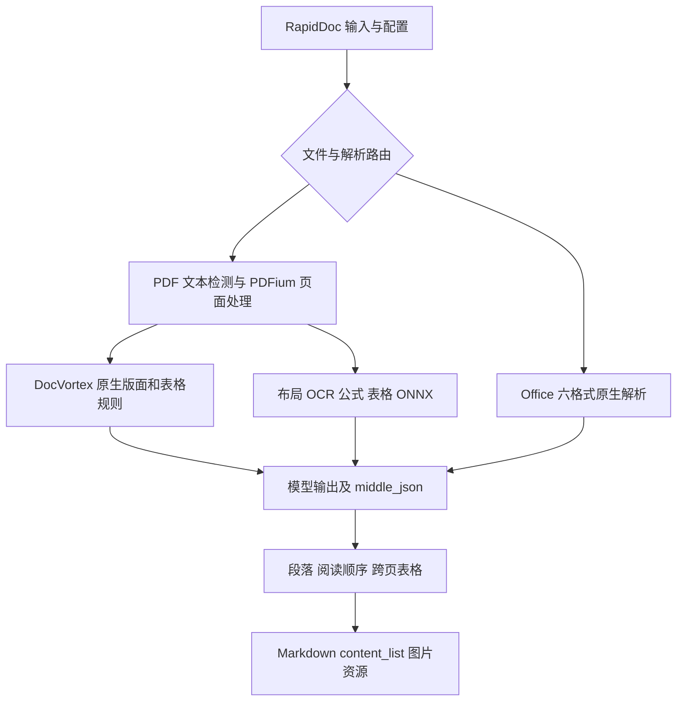

# RapidDoc Rust 改造可行性评估

评估日期：2026-10-22；更新日期：2026-10-23（Python 优先及新增 Rust 参考实现）。代码基线：`d0e98fb`，以当前工作区源码为准。需求来自根目录 `todo.md`。本文是技术评估，不代表已完成 Rust 移植或性能验证；具体任务见同目录 `2026-10-22-rust-migration-plan.md`。

## 1. 结论

**可以迁移到 Rust。本阶段只实现和分发 Python SDK；先交付可安装的 Rust-backed Python 包，供用户验证。Node.js、Java、Go 以及为它们服务的通用 C ABI，须等用户测试 Python 没问题并明确要求后才启动。**

核心仍保持不依赖宿主语言的 Rust API，方便以后扩展；不提前创建其他语言绑定、空 crate、发布流水线或跨语言验收任务。

推荐目标是“Rust 业务核心 + PDFium + ONNX Runtime + 薄语言绑定”。独立 Rust CLI 无需 Python；Python SDK 仍需要 Python，但安装预编译 wheel 不应需要 Rust 编译器或 PyTorch，但不是所有依赖都由纯 Rust 实现：PDFium、ONNX Runtime 以及现有 CUDA 算子仍包含 C/C++。若要求连这些底层依赖也全部重写为 Rust，成本与兼容风险会明显超过本次目标。

两个目标的确定性不同：

- **核心复用：可实现。** 当前验证 Python 分发；其他语言是未来扩展方向，暂不实施。
- **解析加速：有潜力，幅度未知。** 原生 PDF 规则、Office 结构处理、几何计算和重复转换值得优化；ONNX 内核、PDF 渲染已经运行在原生代码中，更换调用语言不会自动使它们加速。

保留当前 RapidDoc 的行为和本地修复作为正确性基线。anydoc、pdf-inspector、oar-ocr 用于借鉴局部实现与分发方式，不能仅凭速度宣传直接替换整个解析器。

## 2. 当前代码的实际规模和边界

本次统计 `rapid_doc/**/*.py` 的物理行数，包含注释、空行、vendor 和以后可移除的后端，不是有效代码行数或迁移工时：

| 范围 | Python 文件数 | 物理行数 | 判断 |
| --- | ---: | ---: | --- |
| 整个 rapid_doc | 529 | 161,303 | 属于完整迁移项目，不是几天内改写的小封装 |
| vendored docvortex_core | 231 | 95,797 | 已包含大量领域规则 |
| 其中 native/pdf | 89 | 56,020 | 原生排版、表格和阅读顺序是主要资产 |
| 其中 native/office | 78 | 25,138 | 六种 Office 格式及公式、图片、二进制兼容 |
| model/formula | 53 | 13,134 | 包含可排除的非 ONNX 实现 |
| model/ocr | 34 | 14,079 | 包含 PyTorch 网络和兼容补丁 |

现有调用链：



关键源码导航：

| 责任 | 当前路径 |
| --- | --- |
| 外部 API、输入输出 | `rapid_doc/main.py`：`RapidDoc`、`RapidDocOutput`、内存 writer |
| PDF 分批、原生与模型路由 | `rapid_doc/backend/pipeline/pipeline_analyze.py`、`batch_analyze.py` |
| 原生布局、补充模型、规则表格适配 | `rapid_doc/model/docvortex_adapter.py` |
| 原生 PDF 规则 | `rapid_doc/_vendor/docvortex_core/analyzers/native/pdf/` |
| Office 格式路由 | `rapid_doc/backend/office/office_analyze.py` |
| Office 结构和二进制解析 | `rapid_doc/_vendor/docvortex_core/analyzers/native/office/` |
| PDF 字符抽取、分类、并发保护 | `rapid_doc/utils/pdf_text_tool.py`、`pdf_classify.py`、`pdfium_guard.py` |
| 输出映射 | `backend/pipeline/model_json_to_middle_json.py`、`backend/office/model_output_to_middle_json.py`（均位于 rapid_doc 下） |
| 跨页表格与阅读顺序 | `rapid_doc/utils/table_merge.py`、`rapid_doc/model/reading_order/` |
| 自定义 ONNX 算子 | `rapid_doc/backend/onnx_ops/`、`native/onnx_ops/src/` |

`docvortex_core/UPSTREAM.md` 固定上游为 0.5.16 / `f5da4e69022f5b0a935fb64579d7f0f7ec7d08b6`，并列出多轮本地修复。`_compute_backend.py` 当前明确只使用 Python fallback。迁移应依据本地代码，而不是重新抓上游覆盖。

**测试资产缺口：** 当前工作区没有 `tests/fixtures/docvortex_migration`，但 `tests/test_office_native_integration.py`、`tests/test_native_core_imports.py` 引用了该目录。`UPSTREAM.md` 引用的部分 `docs/migrations/` 和 `docs/others/` 也不在当前工作区，且这些文档目录被 `.gitignore` 忽略。迁移前必须恢复可分发样本或用可复现生成器补充，不能把缺样本测试统一 skip 后称为通过。

### 2.1 本地 DocVortex Rust：优先复用计算内核，重做运行库边界

检查位置：`D:/CodeProjects/doc/DocVortex/rust`，本地仓库 HEAD 为 `2c1ec66ee52bb37135599af92aa175bd77fc04d7`。工作区另有用户改动，本次只读取；正式复用时记录选中文件哈希及其对应提交，不能把绝对本机路径写进正式 Cargo 依赖。

| crate | 本次统计（含测试、注释、空行） | 已读代码所示职责 | 建议 |
| --- | --- | --- | --- |
| docvortex-core | 36 个 .rs / 10,540 行 | 不访问 Python/PDFium 的计算内核；几何、文本分配/去重/间距、表格候选与合并、图像数值等；PROTOCOL_VERSION=35 | 最优先做同输入差分，通过后按模块迁入 rapiddoc-native/core；不是完整解析流水线 |
| docvortex-pdfium | 8 个 .rs / 2,540 行 | 字符、字体、路径、Form 对象及颜色读取；接收函数地址和句柄，调用方保证 ABI、同库、锁与生命周期 | 复用字段和批量抽取算法；改为 Rust 自有 runtime/句柄适配，不原样暴露 usize 指针接口 |
| docvortex-python | 38 个 .rs / 8,850 行 | 私有 PyO3 扩展、参数转换和原模块协议适配；pdfium.rs 仍借用 Python guard 和 textpage | 借鉴批量转换、错误映射和测试；不将其作为新 SDK 核心依赖 |

已阅读 core 的 contracts.rs，包含合并单元格、L 形拒绝、线段覆盖和字形去重等契约测试。P01 应运行这些测试并添加 RapidDoc 本地修复样本；当前只做源码评审，没有运行该仓库 cargo test 或验证性能。

`docvortex-python` 固定 PyO3 0.28.2 / abi3-py311；当前 RapidDoc 声明支持 Python 3.10，不能直接复制配置后无意抬高最低版本。P06 必须验证所选 PyO3 与目标 Python 版本，保留 3.10 支持或将版本变化单独明确决定。

本地 workspace 声明 `MIT AND Apache-2.0 AND BSD-3-Clause`，移植需逐文件保留来源/许可。无论相邻仓库更新多少，都以 RapidDoc 当前规则及回归结果裁决差异；不把新版 DocVortex 直接视为正确答案。Office/ONNX 不应因发现这些 PDF 计算内核就宣称已由 Rust 覆盖。

## 3. 性能收益应怎样判断

粗略模型：`总耗时 = 读取/识别格式 + PDF解码/渲染 + 模型前处理 + 推理 + 后处理/规则 + 输出`。

假设某文档 80% 时间已在 PDFium/ORT 中，而 Rust 把其余 20% 加速 5 倍，理论总加速只有 `1 / (0.8 + 0.2 / 5) ≈ 1.19` 倍。这是演示，不是本项目测量结果。

值得优先测量的优化点：

1. 原生 PDF 的字符/线段遍历、区间查询、重叠判断和反复排序；优化复杂度通常比简单改写更有效。
2. 避免 PDF 多次打开、同一页多次抽字、同一图片反复编码/base64/解码。
3. Office 从 ZIP/XML/OLE 直接生成结构化数据，减少 Python 对象和 HTML 中间往返。
4. OCR 按宽度分桶、动态 batch、复用 session 和图像缓冲区；所有优化都必须固定相同模型和精度。
5. 有界页面窗口，释放不再使用的像素数据；GPU batch、CPU 线程和文档并发共同限流。

不能直接对 PDFium 页句柄使用 Rayon 并发。现有 `pdfium_guard.py` 有共享锁；[pdfium-render 文档](https://docs.rs/pdfium-render/latest/pdfium_render/)也说明其线程安全通过互斥锁串行调用实现。首版采用单一 PDFium 调用边界、抽取后拥有独立所有权的数据可并行计算。多文档多进程 worker 是后续吞吐选项，另计进程启动、内存和 IPC 成本。

基准须固定硬件、模型 SHA256、PDFium/ORT 版本、EP、线程数、DPI、batch 和输出功能。分别报告首次启动、模型已缓存冷启动、预热后的单文档延迟、并发吞吐、RSS/显存、输出质量。网络下载不得混入纯解析耗时；也不能为了加速关闭公式或降低 OCR 分辨率后称为等价比较。

## 4. 依赖替换清单

以下是候选方案；“可用基础库”不等于“已与 RapidDoc 等价”。锁定版本与编译组合在执行计划 P01 完成。除已单独链接的库外，候选版本/API 仍需实施时验证。

| Python 依赖/能力 | Rust 方案 | 迁移边界与风险 |
| --- | --- | --- |
| onnxruntime / onnxruntime-gpu | `ort`，必要时小范围 `ort-sys` | Rust binding 调用 ORT；保留 CUDA EP、动态 shape、模型元数据与自定义算子能力 |
| onnx 图读写/重写 | 首版发布预处理好的模型；需要运行时重写时用生成的 ONNX protobuf 类型 | `ort` 不是完整的 Python onnx 图编辑替代；外部权重和自定义模型必须另验 |
| rapidocr | 自有适配层，评估 `oar-ocr` / `oar-ocr-core` | 对照本项目 det/rec、印章、排序、裁剪和兼容补丁；禁止直接套新默认模型 |
| pypdfium2 | 优先探针验证 `firecrawl-pdfium` 加必要扩展，与 `pdfium-render` 对照 | 见 4.1；必须覆盖字体、路径、Form、注释等，不能仅凭可渲染即选定 |
| pdftext | 在 PDFium 抽取数据上迁移所需分行/分块行为 | 不是只获取一个字符串；保留空白、CID 质量与阅读顺序 |
| pypdf / reportlab | 按用途使用 PDFium；必要时 `lopdf` | 文档拆合与可视化标注另做适配；测试 PDF 可继续由 Python 生成 |
| python-docx / pypptx-with-oxml / lxml | `zip` + `quick-xml`，必要处局部 XML 树 | 自行迁移 OPC 关系、样式、编号、表格、公式、形状、超链接；不是库级直接替换 |
| mammoth | 直接由 OOXML 生成统一 Table/Span，再输出 HTML | 当前 DOCX 表格调用了 mammoth 内部 API，必须用嵌套表格/图片等样本覆盖 |
| openpyxl | `calamine` 作为值/公式读取候选 + OOXML 增补 | 日期、格式化、合并格、图表、图片、富文本与隐藏区域不能只靠值读取 |
| olefile | `cfb` | 只解决 OLE 容器；DOC piece table、PPT records、XLS BIFF 仍需迁移 |
| Pillow | `image`，字体/绘图按需要接入 | EXIF、alpha、色序、插值、裁剪取整与编码输出必须对照 |
| OpenCV（源码直接 import cv2） | `imageproc` + 定点算法；必要时临时 `opencv` binding | DB 轮廓、透视、minAreaRect、形态学和 resize 的数值差异会改变 OCR |
| numpy | Vec/切片、`ndarray`（张量需要时） | 不把每个数组操作都逐句模拟；保证 dtype、stride、NCHW/NHWC |
| shapely / pyclipper（含间接依赖） | `geo`、经过验证的多边形 offset 实现 | 边界接触、空多边形、精度、裁剪/扩张语义要回归；避免把 bbox 等价为 polygon |
| tokenizers | Rust `tokenizers` | 复用模型 tokenizer 配置；不修改特殊 token 和解码规则 |
| resvg_py | `resvg` / `usvg` / `tiny-skia` | SVG 渲染；不能用 resvg 直接解码 WMF/EMF |
| metafile-render | 受限 WMF/EMF 解析 + display-list + SVG/栅格后端 | 见下一节，单独立项，保留 partial/diagnostics/资源上限 |
| pylatexenc | Unicode→LaTeX 映射与当前包装规则 | 无需移植完整 LaTeX parser |
| ftfy / Unicode 修复 | `unicode-normalization` + 有样本支持的修复规则 | Unicode normalization 不等于 ftfy 的乱码恢复 |
| Magika | 基于签名/容器关系识别，必要时复用其 ONNX 模型 | 不是根据扩展名猜格式；保留加密 OOXML 检查和类型识别回归 |
| pydantic / dataclasses | Rust struct/enum + `serde` + 显式校验 | schema 版本和缺省值有稳定契约，不滥用 serde_json::Value |
| beautifulsoup4 / JSON repair | 结构化生成器；外部 HTML 才评估 parser | 移除 VLM 后很多 JSON repair 用途可删除，但先检查真实调用链 |
| requests / robust-downloader | `reqwest` 或 `ureq` + SHA256/原子缓存 | 超时、重试、并发下载锁、断点策略、代理、离线与损坏缓存处理 |
| loguru / tqdm | `tracing` / CLI 进度展示 | SDK 默认不向 stdout 写日志，避免破坏 JSON 输出 |
| boto3 / FastAPI / Gradio / HTML、Word 导出 | 薄外层适配或保留 Python 可选应用 | 不阻塞 Rust 解析核心；导出 Word 等不属于首个里程碑 |
| torch / torchvision / safetensors 网络加载 / 独立 OpenVINO、Paddle 后端 | 不进入新核心 | 旧配置明确报“不支持”，不悄悄切换模型 |

选型依据：[ort](https://docs.rs/ort/latest/ort/)、[calamine](https://docs.rs/calamine/latest/calamine/)、[quick-xml](https://docs.rs/quick-xml/latest/quick_xml/)、[cfb](https://docs.rs/cfb/latest/cfb/)、[imageproc](https://docs.rs/imageproc/latest/imageproc/)、[geo](https://docs.rs/geo/latest/geo/)、[resvg](https://docs.rs/resvg/latest/resvg/)。

### 4.1 pdfium-rs：适合运行库基础层，当前不能无改动替换完整抽取层

仓库 [firecrawl/pdfium-rs](https://github.com/firecrawl/pdfium-rs) 的 crate 名为 **firecrawl-pdfium**，本次 Cargo.toml 为 0.1.0，依赖 libloading。已读 README、src/lib.rs、src/library.rs、src/text.rs、src/sys/mod.rs 和 src/sys/bindings.rs。

- 可直接评估的能力：运行时动态加载、内存文档、独立拥有的像素/文字结果、渲染坐标变换和类型化错误。crate 本身不携带 PDFium 二进制；wheel 仍需另行打包匹配的运行库。[README](https://github.com/firecrawl/pdfium-rs/blob/main/README.md)
- 当前 PageChar 提供 unicode/code、bounds/loose_bounds/origin；本次函数表尚未包含字体字号/字重、字符角度、text object、路径/Form 遍历等本项目需要的接口。高层 API 也不覆盖完整注释和 PDF 编辑/保存。公开 sys 不等于完整 PDFium 绑定。[text.rs](https://github.com/firecrawl/pdfium-rs/blob/main/src/text.rs)、[bindings.rs](https://github.com/firecrawl/pdfium-rs/blob/main/src/sys/bindings.rs)
- 并发调用通过进程内互斥串行化；Send + Sync 不是 PDFium 并行加速。扩展 raw 调用须使用同一 ffi_lock；持锁时不得再次调用内部取锁的安全 API，否则可能死锁。[library.rs](https://github.com/firecrawl/pdfium-rs/blob/main/src/library.rs)

**选型建议：先验证直接依赖 + 小范围扩展；若补全接口需要大面积 fork，则选 pdfium-render 作为唯一绑定，仅借鉴 pdfium-rs 的 owned buffer、坐标转换和运行库打包方式。** 不预先承诺某一库，不同时部署两套独立 PDFium 生命周期/锁。DocVortex 的批量字段抽取可迁入选定的适配层。

P01 建立能力矩阵：字符/advance 与 ink 框、字体/角度/颜色、路径及 Form 层级变换、图像、注释/链接、页面选择、坏页、内存/关闭顺序。页拆合/保存若仍是必要能力，要补接口或由原始文档页选择替代并证明语义等价，不能悄悄丢功能。

Python 过渡期尤其注意 pypdfium2 与 Rust binding 的锁互不知情：禁止跨运行库传递旧句柄，禁止两条路径用独立锁并发访问同一 PDFium 全局状态。差分基准优先使用独立进程；同进程共存必须先验证统一锁/初始化/销毁协议。正式 Rust 路由应独立拥有从打开到关闭的完整生命周期。

本次读取的文件 blob SHA：Cargo.toml `1344b2aae1ff6007b1281d7b42ab7cb3a801f960`；bindings.rs `2193dc219648d3e675c99720c560ac47ab5713f2`。正式选型固定仓库 commit 和 runtime 哈希，再做编译、样本及 wheel 测试；本次没有执行这些验证。

## 5. 两个需要自行实现的重点

### 5.1 pylatexenc：范围可以收敛

源码中直接使用位于 `office/equation/omml.py`：`UnicodeToLatexEncoder(replacement_latex_protection="braces-all", unknown_char_policy="keep", unknown_char_warning=False)`，后续再处理数学模式及外层包装；`latex_dict.py` 另有本地覆盖。

做法：以当前安装的 2.x 行为生成映射和边界测试，迁移本地覆盖优先级、转义、组合字符、未知字符保留和花括号保护。随后迁移 OMML/MTEF 结构转公式逻辑。Unicode 编码层较小，整个 Office 公式转换层并不小。上游 main 已包含 3.x 发展内容，不能拿它替代当前 `<3` 的行为。[上游说明](https://github.com/phfaist/pylatexenc)

### 5.2 metafile-render：不能假定只是“小轮子”

上游明确包含 WMF/EMF、部分 EMF+、GDI 状态重放、字体替换和 partial diagnostics；存在裁剪、画笔/画刷、坐标变换、嵌入位图和资源限制。跨平台结果还涉及字体与布局。[上游能力与限制](https://github.com/myhloli/metafile-render)

建议顺序：格式/长度校验 → record parser → 有界对象表及 SaveDC/RestoreDC → 几何与变换 → 位图 → 字体/文本 → clip/ROP → EMF+。先按真实样本统计覆盖率。不能支持的操作明确返回 partial 与诊断，并保留原始资源；完整文档仍可输出，但不能将占位图当作图片等价通过。

`resvg` 负责 SVG 到像素；WMF/EMF 到 SVG 的解释层仍需实现。不把 Windows GDI 设成跨平台唯一方案，也不默认引入 Office/LibreOffice 进程。

## 6. ONNX-only 的实际范围

保留现有 ONNX OCR、方向、印章、布局、表格分类、UNET、SLANet 系列及 FormulaNet 路径。所有模型先登记文件/字典/tokenizer SHA256、输入输出、动态轴、归一化、opset、custom domain、EP 和许可证，清单以实际文件为准。

需要明确的功能变化：

- 当前 `rapid_table.py` 的 `UNET_UNITABLE` 明确选用 `EngineType.TORCH`，`table_structure/unitable/main.py` 直接依赖 torch。按本次范围排除该路线；若后续要保留，另做 ONNX 导出与 decoder 验证任务。
- OCR 与公式目录中的 PyTorch 网络定义、训练/转换逻辑不迁入发布运行时。必要的离线模型转换工具可以单独保留在开发侧。
- VLM/OpenAI 自定义路线不进入 Rust 首版；不能因此删除旧 Python 用户所需代码，先在兼容说明中标明范围。
- 只保留 ONNX 不代表所有模型都支持 CPU/GPU 或任意 ORT 版本；每个模型要运行输入/输出探针。

**自定义 CUDA 算子单独处理。** 当前 `create_session()` 会预优化、改写图、注册库并在构造失败时回到原图；公式另有 rewrite。Rust 首版先跑标准图，验证结果一致后，通过 ORT 注册现有 DLL/SO，移植配置和图处理。允许暂时保留 C++/CUDA；不要为追求“全 Rust”重写高风险 CUDA 内核。

优化图缓存键至少含原模型哈希、ORT 版本、EP/设备、精度与优化参数、插件版本。未知自定义模型默认走标准图。推理过程出错不可简单吞掉后静默重跑；错误信息要说明实际 EP、模型和页面。

本次查阅时 oar-ocr 的 manifest 固定 `ort = =2.0.0-rc.13`，docs.rs 的 ort 文档已显示 rc.15。这证明不能让几个 crate 独立追随 latest。先验证并统一一个 ORT binding/runtime 组合，写入 Cargo.lock 与 runtime manifest。[oar-ocr Cargo.toml](https://github.com/GreatV/oar-ocr/blob/main/Cargo.toml)

## 7. 推荐架构及决策记录

以下 ADR 均为本次建议，P01/P02 的验证结果可以修订；没有把尚未跑通的选型视为已批准实现。

| ADR | 决策 | 理由、替代方案与代价 |
| --- | --- | --- |
| 001 | Rust 核心，PDFium/ORT 保留原生库 | 降低解析/推理变化面；纯 Rust PDF 引擎作为后续实验，不作为首版前提 |
| 002 | 模块化单体，不拆微服务 | 先供 Python/CLI 使用、核心不依赖宿主语言；多进程只用于确有收益的 PDFium 吞吐或隔离 |
| 003 | 统一内部文档 IR，兼容 exporter 独立 | 避免 Office/PDF 各造输出；旧 middle_json 保持兼容，不强行改变公开字段 |
| 004 | 一个 ONNX Runtime 层，各模型独立 processor | 统一缓存/设备/错误，保留不同模型前后处理；避免庞大多后端基类 |
| 005 | 逐路由迁移，默认行为仅在验收后切换 | 回归可定位；代价是过渡期保留 Python oracle 与少量桥接 |
| 006 | 当前仅 PyO3 Python 绑定 | 直接调用 Rust 核心；通用 C ABI 与其他 SDK 等用户验证 Python 后明确要求，不作为本期前置条件 |
| 007 | CPU 默认，GPU 可选运行库套件 | 避免 CPU 用户下载 CUDA；增加按平台打包和实机测试成本 |

建议 workspace，按里程碑创建，禁止先生成大量空 crate：

```text
rust/rapiddoc-core/       # IR、坐标、配置、错误、资源上限
rust/rapiddoc-pdf/        # PDFium 边界、字符/路径事实抽取
rust/rapiddoc-native/     # 原生版面、表格、阅读顺序规则
rust/rapiddoc-office/     # OPC、六格式、OMML/MTEF、Office 资源
rust/rapiddoc-inference/  # ORT、模型缓存、OCR/布局/表格/公式 processors
rust/rapiddoc-render/     # Markdown/HTML/旧 JSON exporters、资源命名
rust/rapiddoc/            # 输入路由与流水线，唯一业务入口
rust/rapiddoc-cli/        # parse、models、doctor、capabilities
bindings/python/           # 本期唯一语言绑定，PyO3 + 兼容 RapidDocOutput
```

IR 要包含 Document/Page/Block/Span/Table/Cell/Asset、稳定 ID、来源、reading_order、rowspan/colspan、样式、公式、链接、诊断。PDF 几何显式区分页面 point、归一化框、图像像素、旋转；Office 流式内容不能伪装成可靠 PDF 页坐标。页尺寸、坐标变换和原始页号可追溯。

中间过程用 typed struct，最终对外才序列化。图片使用资产 ID 和字节缓冲区，不在每层 base64。跨页表格/页眉判定保留文档上下文，不能因为页面窗口而丢失相邻页证据。配置归一化后再建 session，核心不读 `.env`、不安装全局 monkey patch。

每个公开方法及非平凡内部方法添加中文 `///` 注释，重点解释输入单位、资源所有权、回退条件和规则依据；FFI `unsafe` 块说明安全前提。保持函数职责单一，避免用宏或泛型隐藏解析规则。

## 8. CPU/GPU 与 Python 分发（其他语言延期）

发布物分三层：语言绑定、平台原生库、模型。模型使用独立版本与哈希清单，支持预下载、离线目录和显式下载；不要首次普通解析时隐式联网。未使用 OCR/布局模型的原生文档不初始化 ORT。

| 平台 | 首轮支持建议 | GPU 承诺 |
| --- | --- | --- |
| Windows x86_64 MSVC | CPU | NVIDIA CUDA 需实机通过后发布 |
| Linux x86_64 glibc | CPU | NVIDIA CUDA 单独套件与基准 |
| macOS arm64 | CPU，纳入第二批 CI | 首版不承诺 CUDA；CoreML 单独实验 |
| Linux arm64 / Windows arm64 / macOS x86_64 | 按二进制来源与测试资源扩展 | 不因为可交叉编译就声称支持 |
| Alpine musl / WASM | 首版不承诺 | ORT/PDFium 分发需另设计 |

以上是支持规划，不是本次已验证的平台矩阵。

CPU 安装包应能获得经过固定版本验证的 CPU ORT/PDFium；GPU 使用独立 runtime 包/套件或明确的用户运行库路径。Python extra 只表达依赖，不自动改变 Rust wheel 编译特性；避免 cpu/gpu 两个包覆盖同名 DLL。可用一个动态加载的 binding，配合互斥选择的运行库目录；一个进程只初始化一套兼容 ORT runtime，发现不同版本请求需明确拒绝。

动态库从显式或受管理的路径加载，依赖查找兼顾 Windows DLL、Linux rpath/运行库、macOS loader 路径。`doctor` 输出已加载库的绝对路径、版本、EP、插件和模型状态。显式 `device=cuda` 不可用时默认报错；只有 `allow_cpu_fallback=true` 才退回 CPU 并返回诊断。CUDA feature 本身不会安装驱动、CUDA/cuDNN；匹配关系以[ORT CUDA 官方说明](https://onnxruntime.ai/docs/execution-providers/CUDA-ExecutionProvider.html)及本项目验证矩阵为准。

本期只实现 PyO3 + maturin：兼容路径/bytes/流、RapidDocOutput 和 markdown/images 解包；计算阶段释放 GIL，Python callback 单独处理。以真实 wheel 验证 Python 版本、资源释放、异常、离线模型和 CPU/GPU 运行库，不能只测开发环境 import。[PyO3](https://pyo3.rs/)

Node.js/napi-rs、Java/JNI、Go/cgo 与通用 C ABI 仅保留为未来方向。P15 先交付 Python 包，由用户实际测试并反馈；**只有用户明确要求启动其他语言后才规划和实现**，自动化测试通过不能代替该指令。当前不生成这些 SDK 的源码、包配置、CI 或安装测试。

## 9. 如何处理当前 Python 冗余

发现的确定性重复：layout 与 formula 的 `inference_engine/onnxruntime/provider_config.py` 文件 SHA256 相同；两者 `utils/download_file.py` 也相同。table 的同名文件不同，不能按文件名直接合并。layout/table 的 `optimization.py` 也不同，应保留各自图变换。

建议迁移时抽出 ModelStore、OrtRuntime、几何与资源组件。旧 Python 仅在能减少过渡维护负担时做小步重构，每次配行为测试；不先重构全库再重写一次。`ModelSingleton`/`AtomModelSingleton` 改为引擎拥有、按规范配置索引的缓存，明确关闭、容量和并发语义。

PDF 与 Office exporter 只共享真正一致的 span 转义、链接、资源和表格渲染；native/grid/model 三类表格识别不能为了“去重”丢掉来源与不同判据。

## 10. 用户提供项目的使用建议

| 项目 | 已核实资料 | 建议借鉴 | 不直接沿用的部分 |
| --- | --- | --- | --- |
| [DocVortex](https://github.com/myhloli/DocVortex) | 上游说明和本地 UPSTREAM/源码 | 本地规则、测试与结构组织 | 不覆盖本地修复；不是重新引入整个外部包 |
| [pdfium-rs](https://github.com/firecrawl/pdfium-rs) | README、manifest、运行库/文字/函数表源码 | 优先验证作为 PDFium runtime 基础层，结合 DocVortex 抽取内核 | 部分必需 API 未封装；依 4.1 决定扩展或仅借鉴 |
| [MinerU](https://github.com/opendatalab/MinerU) | 当前 README、mineru 目录树 | parser/render/types/errors 的职责拆分可进一步按文件研究 | 本次未逐文件评审 4.x 算法；旧 pipeline 文件路径已失效，不照抄 VLM 路线 |
| [oar-ocr](https://github.com/GreatV/oar-ocr) | README 与 Cargo.toml | Rust ONNX、PP-OCRv6、布局/表格 processors、feature 拆分 | 上游默认 Tiny/模型链不等同于本项目；不引入 oar-ocr-vl |
| [anydoc](https://github.com/firecrawl/anydoc) | README 与 Cargo.toml | 统一文档模型、ZIP/XML/CFB 依赖选择和 Python/Node 绑定组织 | 不用它的 Markdown 结果替代 RapidDoc 结构保真；其 hosted OCR 不在目标内 |
| [pdf-inspector](https://github.com/firecrawl/pdf-inspector) | README 与 Cargo.toml | 检测/抽取分层、可选 OCR、运行库显式加载 | 最新版本已提供可选 oar-ocr/PDFium OCR；不能按旧印象描述为永远无 OCR，也不能把其基准当本项目收益 |
| [metafile-render](https://github.com/myhloli/metafile-render) | README 与本地调用位置 | 有界 record 重放、diagnostics | 不是小型完整替代任务 |
| [pylatexenc](https://github.com/phfaist/pylatexenc) | README 与本地调用位置 | 编码映射与兼容边界 | 不移植未使用的 latexwalker/latex2text |

引用代码/映射表前固定 commit、保留来源与许可证。当前 MinerU README 标注为基于 Apache 2.0 并含附加条件的许可证；不能把历史版本或当前所有文件都当作无差别 Apache-2.0。现有 vendor 字体、Unicode 数据、模型权重也分别记录来源。这里只列迁移工程要求，不作许可证兼容性的法律结论。

本次读取的上游 manifest 文件 blob SHA：oar-ocr `f53a6ffea1eb3b049ef3f9044f9a651eafebdf6e`；anydoc `2a334b7223a6cb08db7382df5a009e68971a1efe`；pdf-inspector `c4e038de9ba79bba0bd36a25492b0c4d9fd81cc5`。这些是文件 blob，不是仓库 commit；正式复用时重新固定仓库 commit。

## 11. 验证结果、尚未验证事项与投入判断

2026-10-22 初次评估执行（本次文档更新未重跑）：

```powershell
.venv\Scripts\python.exe -m pytest tests/test_text_boundary.py tests/test_native_table_spacing.py tests/test_native_table_rotation.py tests/test_rule_table_routing.py tests/native_office/test_text_utils.py -q
```

结果 **75 passed in 5.29s**。本机 `rustc`、`cargo` 均为 1.98.1；只验证了命令存在与版本，未验证链接器、Rust 依赖编译、CUDA 或多平台产物。没有跑全量集成测试、没有 Rust 性能样本，不能由此断言迁移已兼容。

主要未决项：完整回归语料、全部模型的标准 ONNX 等价性、PDFium 字符/路径信息覆盖、WMF/EMF 覆盖量、旧 Office 富文本/图表、运行库打包以及跨平台 GPU 实机验证。

原 17–34 人周估算包含其他语言开发，且尚未计入本地 Rust 内核复用，本次不继续作为当前范围的总排期。P01 输出“可直接复用 / 需适配 / 需重写”的模块清单后重新估算。当前交付顺序为 CPU 原生 PDF Python 预览 → ONNX/Office 能力逐步覆盖 → Python 实包测试与用户反馈；其他语言不计入本期交付或验收。AI 可以加快实现，不能替代语料、行为差分与运行库实机验证。

## 已确定的目录与命名

Rust 源码统一放在 `rust/rapiddoc-*`，根 `Cargo.toml` 管理 workspace，Python 绑定放在 `bindings/python/`。Rust 主 crate 为 `rapiddoc`。Python 预览发行包名为 `rapid-doc-rust`，导入名为 `rapid_doc_rust`，原生扩展为 `rapid_doc_rust._native`；现有 `rapid_doc` 保留。名称是项目约定，尚未验证注册表可用性。
